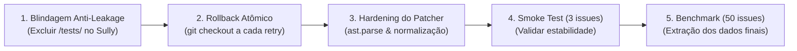

# Estrutura da Apresentação: Ciclo de Vida e Estado Atual do Projeto LIARA

**Público-Alvo:** Professores Universitários, Orientador e Banca Avaliadora (ITA)  
**Tom:** Acadêmico, direto, transparente, profissional e orientado a resultados empíricos  
**Formato:** Conteúdo sequencial em slides estruturados, pronto para transferência em PowerPoint, Google Slides, Keynote ou LaTeX Beamer.

---

## Slide 1: Título & Identificação Institucional

### **Projeto LIARA — Lean Isolated Agents for Repair Automation**
#### *Correção Automática de Programas Descentralizada via Modelos de Linguagem Compactos e Locais*

* **Instituição:** Instituto Tecnológico de Aeronáutica (ITA)
* **Contexto Acadêmico:** Trabalho de Conclusão de Curso (TCC) & Artigo Científico (Padrão IEEE TSE)
* **Autores:** Ítalo Silva, Carol Yamaguchi
* **Orientador:** Prof. Dr. Alison Panisson
* **Objetivos da Apresentação:**
  1. Apresentar os marcos de desenvolvimento e entregáveis consolidados do framework.
  2. Compartilhar um diagnóstico empírico transparente dos testes de estresse em hardware de consumo.
  3. Solicitar direcionamento estratégico da orientação sobre o escopo experimental e a consolidação do artigo.

> **Notas do Apresentador:**  
> *Iniciar destacando que a infraestrutura completa do LIARA (orquestrador, agentes, isolamento em Docker e amostragem de dados) está operacional, e que a reunião tem como meta revisar o diagnóstico empírico dos primeiros testes em lote para balizar a rodada final de experimentos.*

---

## Slide 2: Contexto Acadêmico & Tese Central

### **Superando o Monopólio da Nuvem na Correção Automática de Código (APR)**

* **O Cenário Atual da Literatura:**
  * As soluções dominantes de APR baseadas em LLMs dependem fortemente de APIs proprietárias em nuvem (ex: GPT-4 Turbo, Claude 3.5 Sonnet).
  * **Barreiras Críticas:** Custo financeiro proibitivo (milhares de dólares em tokens), alta latência de rede e risco severo de vazamento de propriedade intelectual ao enviar códigos privados para servidores externos.
* **A Pergunta de Pesquisa:**
  * *É viável utilizar Modelos de Linguagem Compactos (SLMs), executados 100% localmente em hardware de consumo, para reparar bugs reais de software de forma competitiva?*
* **A Tese Central do LIARA:**
  * É viável e custo-efetivo descentralizar a correção automática através de um Sistema Multiagente (MAS) baseado em SLMs abertos (ex: `Qwen2.5-Coder:14b` ou `Llama-3.1:8B`), com **custo zero de API**, **privacidade absoluta** e **sem fine-tuning prévio**, avaliado no benchmark padrão da indústria **SWE-bench Verified**.

> **Notas do Apresentador:**  
> *Ressaltar o apelo prático do projeto: viabilizar pesquisa de ponta em engenharia de software para laboratórios universitários sem grandes orçamentos de nuvem e para setores estratégicos (aeroespacial, defesa) com requisitos rigorosos de privacidade.*

---

## Slide 3: Posicionamento Científico & Lacuna na Literatura

### **O Mapeamento do "Quadrante Inexplorado"**

```
                       │ Com Fine-Tuning          │ Sem Fine-Tuning (Off-the-Shelf)
───────────────────────┼───────────────────────────┼─────────────────────────────────
 Nuvem Comercial (API) │ SWE-smith (40,2% Pass@1)  │ SWE-agent (12,5% Pass@1, GPT-4)
                       │ Custo: ~$1.360 em APIs    │ Custo elevado e risco de dados
───────────────────────┼───────────────────────────┼─────────────────────────────────
 Local / Custo Zero    │ Lacuna na Literatura      │ ★ LIARA (Nossa Linha de Base)
                       │                           │ Custo $0, GPU de Consumo, Privacidade
```

* **A Lacuna Científica:** Não há na literatura atual um estudo empírico sistemático que meça a viabilidade de APR utilizando múltiplos agentes especializados acoplados a modelos pequenos locais sem treinamento adicional.
* **A Contribuição do LIARA:**
  * O LIARA não visa superar modelos gigantes de 40B+ em acurácia absoluta, mas estabelecer a **linha de base do quadrante democratizado**: quantificar o trade-off entre acurácia (Pass@1) e custo ($0), isolando os gargalos da execução local.

> **Notas do Apresentador:**  
> *Deixar claro que o artigo não promete milagres contra modelos de 70B fine-tunados, mas preenche uma lacuna metodológica essencial ao definir o piso empírico do que é possível fazer com hardware acessível.*

---

## Slide 4: Arquitetura do Sistema LIARA & Decomposição em Papéis

### **Superando os Limites dos Modelos Pequenos através da Especialização**

* Em vez de confiar todo o processo a um único prompt genérico, o LIARA divide a tarefa em fases rígidas com papéis discretos:

```
[Issue + Test Patch do SWE-bench]
               │
               ▼
┌────────────────────────────────────────────────────────┐
│ Fase 0: Análise Estática Determinística (Sem LLM)      │
│ • Mapeamento AST (símbolos/funções)                    │
│ • Busca Vetorial Semântica (nomic-embed-text)          │
│ • Regex de tracebacks (extrai causas prováveis)        │
└──────────────────────────────┬─────────────────────────┘
                               ▼
┌────────────────────────────────────────────────────────┐
│ Fase 1: Reprodução do Bug em Sandbox Docker            │
│ • Sobe container isolado e confirma falha do teste     │
└──────────────────────────────┬─────────────────────────┘
                               ▼
┌────────────────────────────────────────────────────────┐
│ Fase 2: Sully (O Arquiteto - SLM)                      │
│ • Localiza a falha e retorna JSON: {"file", "function"}│
└──────────────────────────────┬─────────────────────────┘
                               ▼
┌────────────────────────────────────────────────────────┐
│ Fase 3: Loop Iterativo de Reparo (Até N tentativas)    │
│ • Codey (Coder - SLM): Gera bloco SEARCH/REPLACE       │
│ • The Scalpel: Aplica patch via fuzzy matching         │
│ • Validação Sintática: ast.parse() prévio em memória   │
│ • Execução no Docker: Roda suite de testes da issue    │
│ • Vera (QA Determinístico): Extrai falhas dos logs     │
└────────────────────────────────────────────────────────┘
```

> **Notas do Apresentador:**  
> *Explicar que a Fase 0 elimina cerca de 70% do ruído do repositório antes que qualquer token seja enviado ao SLM, evitando estouro de contexto e economizando capacidade computacional.*

---

## Slide 5: Inovações Metodológicas de Engenharia para SLMs

### **Princípios de Concepção Adaptados às Restrições de Modelos Menores**

1. **Vera Programática (Verificação sem LLM):**
   * *Problema:* Usar um SLM para julgar se o teste passou gerava alucinações e aprovações falsas.
   * *Solução:* A Vera é 100% algorítmica. Analisa códigos de saída e tracebacks brutos do Docker, garantindo veredito determinístico a custo computacional zero.
2. **Injeção Progressiva de Contexto:**
   * O código é injetado em camadas crescentes (Nível 1: apenas a função alvo; Nível 2: classe e contexto imediato; Nível 3: módulo expandido), evitando poluir a janela de contexto de modelos de 8B/14B.
3. **Filtro Sintático Prévio (`ast.parse`):**
   * Antes de acionar o container Docker, o patch gerado é validado sintaticamente em memória. Patches com erros de sintaxe são rejeitados de imediato, economizando tempo de inicialização de container.

> **Notas do Apresentador:**  
> *Enfatizar que cada uma dessas decisões visa proteger o modelo menor de suas fraquezas conhecidas: janela de atenção reduzida e sensibilidade a ruído no prompt.*

---

## Slide 6: Marcos Concluídos & Entregáveis Prontos

### **Ativos de Software e Pesquisa Já Consolidados no Repositório**

* **Evolução do Ciclo de Vida do Software:**
  * **v3.3 – v3.4:** Modularização dos agentes (Sully, Codey, Vera) e introdução do retry guiado por feedback de teste.
  * **v4.0 (Inteligência Híbrida):** Incorporação de AST, busca vetorial (`nomic-embed-text`) e persistência de estado em JSON.
  * **v4.1 – v4.1.1:** Adoção de Modo JSON estrito no Sully e resolução de conflitos de dependências em testes.
  * **v4.2.0 (Arquitetura Fail-Fast):** Remoção de blocos `try-except` genéricos que mascaravam falhas, permitindo rastreabilidade direta da causa-raiz.
* **Entregáveis Físicos Disponíveis:**
  * **Motor de Execução:** [`main_orchestrator.py`](file:///home/bridge/Documentos/sma_liara/openclaw_swe_benchmark/local_execution/main_orchestrator.py).
  * **Pipeline de Dados SWE-bench:** [`download_swebench.py`](file:///home/bridge/Documentos/sma_liara/openclaw_swe_benchmark/local_execution/download_swebench.py) com amostragem balanceada e reprodutível (`seed=42`).
  * **Manuscrito Acadêmico:** Estrutura completa montada no modelo oficial da IEEE Computer Society ([`main_article.tex`](file:///home/bridge/Documentos/sma_liara/Computer_Society_LaTeX_template/main_article.tex)) e base BibTeX ([`references.bib`](file:///home/bridge/Documentos/sma_liara/Computer_Society_LaTeX_template/references.bib)).

> **Notas do Apresentador:**  
> *Reforçar que toda a infraestrutura de engenharia e a estrutura do artigo estão concluídas; a equipe não está partindo do zero, mas na fase de refinamento experimental.*

---

## Slide 7: Testes Empíricos & O Diagnóstico de Estresse

### **Execução em Larga Escala no Hardware do Laboratório**

* **O Ambiente de Teste:** Estação de trabalho com GPU AMD Radeon RX 580 (8GB VRAM) e 64GB de memória RAM, executando modelos via Ollama.
* **O que Operou com Sucesso:**
  * O fluxo orquestrado foi capaz de processar **49 instâncias reais** do benchmark, clonando repositórios complexos (`django`, `sympy`, `astropy`, `scikit-learn`), levantando containers Docker, chamando os agentes e gerando relatórios de estado individuais (`state_*.json`).
* **O Diagnóstico do Teste de 300 Issues (Commit `7b30c67`):**
  * Tentar rodar um lote massivo de 300 instâncias sem limites de tempo gerou saturação de recursos, timeouts de processo e instabilidade no socket do Docker.
  * Esse teste forneceu uma base de diagnósticos profunda que isolou com precisão cirúrgica os gargalos do sistema.

> **Notas do Apresentador:**  
> *Apresentar o teste de 300 issues como uma etapa necessária de estresse que revelou os limites físicos do hardware e as armadilhas mecânicas do código.*

---

## Slide 8: Diagnóstico Técnico: Por que as Tentativas Anteriores Falharam?

### **Análise Factual das 49 Instâncias Testadas no SWE-bench Verified**

* **Resultado Quantitativo Atual:** **0 Acertos Válidos (0% Pass@1)**
  * *48 instâncias:* Não resolvidas.
  * *1 instância (`sympy-13551`):* Registrada como resolvida, mas **desqualificada por Vazamento de Dados (Data Leakage)**. O agente Sully selecionou e alterou o próprio arquivo de teste (`tests/test_products.py`). Pelas regras do SWE-bench, modificar arquivos de teste anula a submissão.

```
Distribuição dos Modos de Falha Identificados nos Logs:
┌──────────────────────────────────────────────────────────┬──────────┐
│ Categoria da Falha                                       │ Ocorrên. │
├──────────────────────────────────────────────────────────┼──────────┤
│ Falha no Patch (The Scalpel: desalinhamento de indent/CRLF) 136      │
│ Erro de Sintaxe gerado pelo SLM (parêntese sem fechar, etc) 53       │
│ Divergência no Ambiente Docker (comando/dependência falta)│ 48       │
│ Vazamento de Dados (Sully apontou para pasta de teste)   │ 1        │
└──────────────────────────────────────────────────────────┴──────────┘
```

* **Conclusão Técnica Central:** As falhas observadas decorrem de **gargalos mecânicos e de formatação** (aplicador de patch e validação de sintaxe), e não de incapacidade intrínseca de raciocínio da arquitetura multiagente.

> **Notas do Apresentador:**  
> *Manter total transparência com os professores. Demonstrar maturidade acadêmica ao reconhecer que o vazamento de dados foi diagnosticado e que os erros estão catalogados e possuem soluções claras.*

---

## Slide 9: Plano de Ação Imediato (Sprint de Destravamento)

### **Cinco Ações Práticas para Desbloquear os Resultados Empíricos**



1. **Blindagem Anti-Leakage do Sully:** Implementar filtro estrito via expressão regular impedindo a seleção de qualquer caminho que contenha `/test`, `/tests`, `test_` ou `_test.py`.
2. **Rollback Atômico Determinístico:** Assegurar que `git checkout -- <arquivo>` seja executado antes de cada nova tentativa do Codey, impedindo que edições corrompidas anteriores poluam a próxima iteração.
3. **Hardening do Patcher e Pré-Validação:** Normalizar quebras de linha (`\r\n` $\rightarrow$ `\n`) no *The Scalpel* e validar sintaxe com `ast.parse()` antes de subir o Docker.
4. **Smoke Test Controlado:** Executar uma amostra de 3 issues para validar o pipeline sem travamentos.
5. **Execução do Benchmark Final e Conclusão do Artigo:** Rodar o benchmark oficial na amostra balanceada de 50 issues (`swebench_sample_50.json`) e inserir os números no LaTeX.

> **Notas do Apresentador:**  
> *Mostrar aos professores que o caminho para destravar o benchmark está planejado em etapas incrementais e com baixo risco técnico.*

---

## Slide 10: Pontos para Discussão & Orientações dos Professores (Parte 1)

### **Direcionamento Solicitado: Metodologia Experimental & Escopo**

#### **Ponto de Discussão 1: Tamanho da Amostra do Benchmark (50 vs. 30 Issues)**
* *Contexto:* Testar 300 issues em hardware local de consumo revelou-se computacionalmente inviável. Temos pronta uma amostra balanceada com `seed=42` contendo **50 issues**. No entanto, 50 issues com 3 retries cada exigem cerca de 25 a 40 horas contínuas de processamento.
* *Pergunta para a Orientação/Banca:* **Na visão dos professores, uma amostra estratificada de 50 issues é o ideal para o artigo, ou seria aceitável consolidar uma amostra de 30 issues para acelerar o ciclo de iteração e garantir a defesa no prazo?**

#### **Ponto de Discussão 2: Estratégia de Avaliação de Modelos (Qwen 14B vs. Comparativo)**
* *Contexto:* Nosso modelo principal é o `Qwen2.5-Coder:14b`, mas dispomos de dados preliminares com o `Llama-3.1:8B`.
* *Pergunta para a Orientação/Banca:* **O artigo deve focar exclusivamente em uma análise aprofundada do Qwen-14B, ou é preferível incluir uma tabela comparativa direta entre Qwen-14B e Llama-8B para evidenciar o impacto da escala de parâmetros em APR local?**

> **Notas do Apresentador:**  
> *Fazer uma pausa para ouvir os comentários e registrar as preferências dos professores sobre o volume amostral e a comparação de modelos.*

---

## Slide 11: Pontos para Discussão & Orientações dos Professores (Parte 2)

### **Direcionamento Solicitado: Enquadramento no Artigo & Cronograma**

#### **Ponto de Discussão 3: Enquadramento de Resultados Negativos e Falhas Mecânicas**
* *Contexto:* O teste empírico revelou que mais de 70% das falhas decorreram de limitações mecânicas (aplicação de patch difusa e vazamento de dados de teste), e não de raciocínio de código.
* *Pergunta para a Orientação/Banca:* **Qual é a melhor abordagem para apresentar esses achados no artigo? Os professores recomendam dar destaque a esses gargalos na seção de *Ameaças à Validade / Discussão*, tratando a caracterização dos erros de modelos pequenos como uma contribuição científica em si?**

#### **Ponto de Discussão 4: Validação do Cronograma de Finalização**
* *Proposta de Cronograma:*
  * **Etapa 1:** Implementação dos ajustes do Sprint de Destravamento + Smoke Test de 3 issues.
  * **Etapa 2:** Execução do benchmark consolidado na GPU local e compilação dos percentuais de Pass@1.
  * **Etapa 3:** Substituição dos placeholders `X%` no arquivo `main_article.tex`, geração de gráficos e revisão bibliográfica.
  * **Etapa 4:** Revisão final com o orientador e preparação para a submissão/defesa.
* *Pergunta para a Orientação/Banca:* **Este planejamento atende às datas limites institucionais do ITA para o TCC?**

> **Notas do Apresentador:**  
> *Agradecer a atenção da banca e do orientador, abrindo espaço para debate, recomendações e alinhamento dos próximos passos.*
