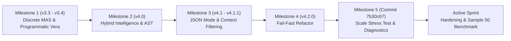
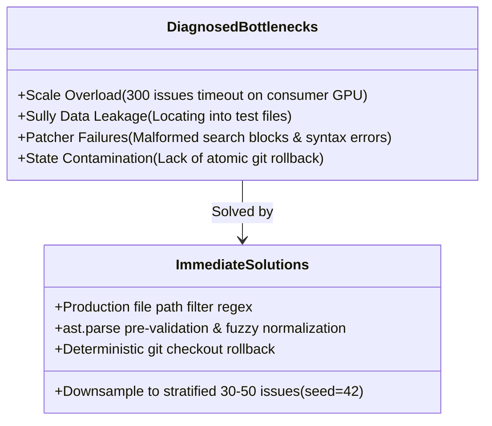
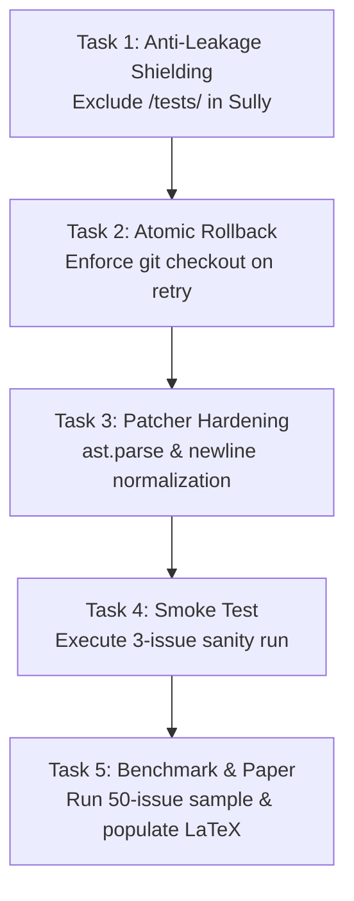

# LIARA Project Lifecycle Documentation
**Framework:** *Lean Isolated Agents for Repair Automation* (LIARA)  
**Institution:** Instituto Tecnológico de Aeronáutica (ITA)  
**Academic Target:** Final Graduation Thesis (TCC) / IEEE Transactions on Software Engineering (TSE)  
**Authors:** Ítalo Silva, Carol Yamaguchi | **Advisor:** Prof. Dr. Alison Panisson  
**Documentation Specialist:** Project Lifecycle & Architecture Audit Report  

---

## Executive Summary

This document provides a systematic, unified record of the **LIARA** (*Lean Isolated Agents for Repair Automation*) project lifecycle, synthesized from [`CONTEXTO_PROJETO.md`](file:///home/bridge/Documentos/sma_liara/CONTEXTO_PROJETO.md) and complementary repository artifacts. It chronicles the project's inception, structural architecture, development milestones, technological stack, key diagnostic outcomes, and immediate strategic roadmap.

---

## 1. Project Initiation and Scope

### 1.1 Academic & Scientific Context
Automated Program Repair (APR) using Large Language Models (LLMs) has historically been dominated by resource-intensive paradigms:
1. Proprietary, high-latency cloud models (e.g., GPT-4 Turbo, Claude 3.5 Sonnet) requiring expensive API access and exposing sensitive codebases to external endpoints.
2. Large fine-tuned models (e.g., SWE-smith 32B) demanding thousands of dollars in trajectory generation and substantial enterprise-grade compute clusters.

LIARA was conceived at the **Instituto Tecnológico de Aeronáutica (ITA)** to challenge this paradigm. The project investigates whether decentralized, role-specialized Multi-Agent Systems (MAS) can achieve competitive APR performance when restricted exclusively to compact open weights running entirely on local consumer hardware.

### 1.2 The Central Thesis
> **Central Thesis:** It is viable, highly cost-effective, and fully reproducible to automate end-to-end software program repair through a Multi-Agent System (MAS) composed exclusively of Small Language Models (SLMs, e.g., `Qwen2.5-Coder:14b` or `Llama-3.1:8B`), running locally on consumer hardware without fine-tuning, zero API costs, and absolute data privacy, achieving defensible results on the industry-standard **SWE-bench Verified** benchmark.

### 1.3 Scientific Positioning & The Unexplored Quadrant
As codified in [`artefatos/liara_positioning.md`](file:///home/bridge/Documentos/sma_liara/artefatos/liara_positioning.md), contemporary literature left a distinct void:

| Dimension | With Fine-Tuning | Zero Fine-Tuning (Off-the-Shelf) |
| :--- | :--- | :--- |
| **Cloud / Commercial APIs** | **SWE-smith** (40.2% Pass@1, ~$1,360 API cost) | **SWE-agent** (12.5% Pass@1 with GPT-4 Turbo) |
| **Local / Zero API Cost** | *Academic Gap* | **LIARA (Empirical Pioneer)** |

LIARA does not seek to defeat 40-billion-parameter cloud ensembles in raw Pass@1 score. Instead, it defines the **empirical baseline for democratized APR**, isolating the architectural variables (context management, static extraction, AST-based gating, programmatic feedback loops) that make local repair viable for standard research labs and air-gapped commercial environments.

### 1.4 Scope Boundaries & Resource Envelope
- **Compute Envelope:** Tested and constrained to consumer-tier hardware (e.g., AMD Radeon RX 580 8GB VRAM, 64GB RAM).
- **Inference Runtime:** Local model serving via Ollama; strictly zero reliance on remote cloud APIs.
- **Evaluation Standard:** Princeton's **SWE-bench Verified** dataset (real-world Python issues from repositories such as `sympy`, `django`, `pytest`, `requests`).

---

## 2. Key Milestones and Deliverables



### 2.1 Evolutionary Milestones Throughout the Lifecycle

#### Milestone 1: Discrete MAS Inception & Programmatic Verification (v3.3.0 – v3.4.0)
- **Actions:** Decomposed the monolithic repair task into distinct specialized roles: **Sully** (Architect/Localizer), **Codey** (Coder/Patcher), and **Vera** (Quality Assurance). Replaced non-deterministic LLM evaluation with programmatic test output parsing.
- **Decisions:** Converted Vera from an LLM prompt into an automated log parser to eliminate hallucinated test verdicts.
- **Achievements:** Implemented guided retries where test tracebacks are fed directly into Codey's subsequent attempt.
- **Outcomes:** Benchmarked early feasibility with `Llama-3.1:8B` on a 5-issue pilot, demonstrating zero cost but highlighting context window bottlenecks in 8B models.

#### Milestone 2: Hybrid Intelligence & AST Integration (v4.0)
- **Actions:** Integrated deterministic static analysis into Phase 0 prior to any LLM invocation. Introduced Python AST symbol mapping, vector search via `nomic-embed-text`, JSON state tracking (`state_*.json`), and progressive context levels (Levels 1, 2, 3).
- **Decisions:** Reduced LLM input payloads by pruning irrelevant codebase files deterministically before Sully inspects the bug.
- **Achievements:** Context reduction by up to 70%, preventing context overflows and dramatically lowering local inference latency.
- **Outcomes:** Modularized codebase structure in [`openclaw_swe_benchmark/local_execution/main_orchestrator.py`](file:///home/bridge/Documentos/sma_liara/openclaw_swe_benchmark/local_execution/main_orchestrator.py).

#### Milestone 3: Deterministic Structuring & Schema Hardening (v4.1 – v4.1.1)
- **Actions:** Enforced strict JSON output schemas on Sully (`{"file": "...", "function": "..."}`) and fixed Docker test-bed dependency conflicts.
- **Decisions:** Mandated schema compliance to prevent downstream pipeline crashes caused by unstructured conversational replies from SLMs.
- **Achievements:** Eliminated JSON decoding exceptions and logged embedding similarity distributions for post-hoc inspection.

#### Milestone 4: Fail-Fast Architectural Refactoring (v4.2.0)
- **Actions:** Systematically stripped out silent `try-except` catch-all blocks across the orchestrator.
- **Decisions:** Prioritized debuggability over false robustness; unhandled exceptions must immediately halt execution to expose root causes.
- **Outcomes:** Revealed previously hidden failure modes in patch application, Docker socket bindings, and environment variables.

#### Milestone 5: The 300-Issue Stress Test & Bottleneck Diagnostic (Commit `7b30c67`)
- **Actions:** Executed a massive batch run against 300 SWE-bench Verified instances on consumer hardware.
- **Decisions:** Subjected the pipeline to full-scale stress to identify scaling thresholds.
- **Achievements:** Generated rich diagnostic data on system stability, Docker container lifecycle leaks, and patcher failure modes.
- **Outcomes & Diagnosis:** The execution failed due to resource exhaustion, session timeouts, and critical edge cases (detailed in Section 4). This diagnostic was the turning point leading directly to the current stabilization sprint.

### 2.2 Tangible Project Deliverables

| Deliverable Asset | Location | Purpose & Function |
| :--- | :--- | :--- |
| **Main Orchestration Engine** | [`main_orchestrator.py`](file:///home/bridge/Documentos/sma_liara/openclaw_swe_benchmark/local_execution/main_orchestrator.py) | Central engine executing Phases 0–3, Docker orchestration, agent loops, and AST parsing. |
| **Dataset Sampling Pipeline** | [`download_swebench.py`](file:///home/bridge/Documentos/sma_liara/openclaw_swe_benchmark/local_execution/download_swebench.py) | Downloads SWE-bench Verified instances and generates reproducible stratified subsets (`seed=42`). |
| **Stratified Evaluation Dataset** | [`data/swebench_sample_50.json`](file:///home/bridge/Documentos/sma_liara/openclaw_swe_benchmark/local_execution/data/) | Standardized 50-issue sample representing diverse complexity for local benchmarking. |
| **System Architecture Blueprint** | [`liara_architecture.md`](file:///home/bridge/Documentos/sma_liara/liara_architecture.md) | Formal Mermaid architecture diagrams illustrating message flows and retry mechanisms. |
| **Academic Positioning Brief** | [`liara_positioning.md`](file:///home/bridge/Documentos/sma_liara/artefatos/liara_positioning.md) | Literature review comparing LIARA against SWE-agent, SWE-smith, and defining academic novelty. |
| **Academic Manuscript (LaTeX)** | [`main_article.tex`](file:///home/bridge/Documentos/sma_liara/Computer_Society_LaTeX_template/main_article.tex) | Complete IEEE Transactions on Software Engineering template awaiting final empirical figures. |
| **Curated Academic Bibliography** | [`references.bib`](file:///home/bridge/Documentos/sma_liara/Computer_Society_LaTeX_template/references.bib) | BibTeX database containing foundational references across APR, LLMs, and multi-agent systems. |

---

## 3. Technologies and Methodologies Employed

### 3.1 Multi-Agent Separation of Concerns (Role Decomposition)
Rather than relying on a single generalist model, LIARA employs **discrete specialized roles** tailored to the constrained capabilities of SLMs:

```
[Issue + Test Patch]
        │
        ▼
┌────────────────────────────────────────────────────────┐
│  Phase 0: Non-LLM Static Analysis                      │
│  • AST Mapping: Extracts functions, classes, and paths │
│  • Embedding Search: nomic-embed-text dense retrieval  │
│  • Error Pattern Matcher: Traceback regex extraction   │
└────────────────────────────────────────────────────────┘
        │
        ▼
┌────────────────────────────────────────────────────────┐
│  Phase 1: Bug Reproduction in Docker Sandbox           │
│  • Spawns clean repo container (liara-<id>)            │
│  • Executes issue test patch                           │
│  • Verifies test failure (confirms reproducible bug)   │
└────────────────────────────────────────────────────────┘
        │
        ▼
┌────────────────────────────────────────────────────────┐
│  Phase 2: Sully (The Architect - SLM)                  │
│  • Inputs: Issue text + static candidates              │
│  • Output: Strict JSON {"file": "...", "function": ...}│
└────────────────────────────────────────────────────────┘
        │
        ▼
┌────────────────────────────────────────────────────────┐
│  Phase 3: Iterative Repair Loop (Max Retries: N)       │
│  ┌──────────────────────────────────────────────────┐  │
│  │ Codey (The Coder - SLM)                          │  │
│  │ Generates SEARCH/REPLACE patch block             │  │
│  └──────────────────────┬───────────────────────────┘  │
│                         ▼                              │
│  ┌──────────────────────────────────────────────────┐  │
│  │ The Scalpel (Fuzzy Patcher)                      │  │
│  │ Strips indentation, normalizes whitespace & CRLF │  │
│  └──────────────────────┬───────────────────────────┘  │
│                         ▼                              │
│  ┌──────────────────────────────────────────────────┐  │
│  │ Pre-Validation Gate                              │  │
│  │ ast.parse() checks syntax before Docker launch   │  │
│  └──────────────────────┬───────────────────────────┘  │
│                         ▼                              │
│  ┌──────────────────────────────────────────────────┐  │
│  │ Docker Execution & Test Run                      │  │
│  │ Runs SWE-bench evaluation harness                │  │
│  └──────────────────────┬───────────────────────────┘  │
│                         ▼                              │
│  ┌──────────────────────────────────────────────────┐  │
│  │ Vera (Programmatic QA Evaluator)                 │  │
│  │ Parses test logs; if failed, crafts retry prompt │  │
│  │ Trigger atomic rollback (git checkout)           │  │
│  └──────────────────────────────────────────────────┘  │
└────────────────────────────────────────────────────────┘
```

1. **Sully (The Architect):** Specializes in fault localization. Ingests issue descriptions, stack traces, and AST symbol tables to output the exact target file and function in strict JSON.
2. **Codey (The Coder):** Specializes in patch synthesis. Receives the scoped source code chunk and generates strict `<<<<<<< SEARCH ... ======= ... >>>>>>> REPLACE` diff blocks. Operates with progressive context elevation (starting narrow at Level 1, expanding to Level 2 or 3 if previous attempts fail).
3. **The Scalpel (Patcher Component):** A specialized algorithmic patch applier that handles whitespace, indentation divergence, and line-ending variations between SLM outputs and repository files.
4. **Vera (The QA Specialist):** A deterministic, non-LLM verifier. Analyzes raw test execution outputs from Docker, detects assertion failures and tracebacks, categorizes failures, and generates targeted context payloads to guide Codey on subsequent retries.

### 3.2 Technology Stack Matrix

| Layer | Technology / Tool | Rationale & Deployment |
| :--- | :--- | :--- |
| **Model Serving & Inference** | **Ollama** | Lightweight, high-throughput local SLM runner supporting quantized GGUF weights. |
| **Language Models** | `Qwen2.5-Coder:14b` & `Llama-3.1:8B` | State-of-the-art compact open-weight coding models fitting in 8GB–16GB VRAM. |
| **Vector Embeddings** | `nomic-embed-text` | High-efficiency 768-dim local dense embedding model for semantic file/code retrieval. |
| **Static Code Analysis** | Python `ast` & Deterministic Regex | Fast, zero-overhead syntax tree navigation and syntax pre-validation. |
| **Container Sandboxing** | **Docker** (`docker-py` API) | Total environmental isolation; prevents host pollution and reproduces exact repository dependencies. |
| **Benchmarking Suite** | **SWE-bench Verified** | Gold standard curated benchmark containing 500 validated real-world GitHub issues. |
| **Hardware Platform** | AMD RX 580 (8GB VRAM) / 64GB System RAM | Demonstrating feasibility on consumer-grade workstation hardware. |

### 3.3 Core Methodological Decisions

> [!NOTE]
> **Key Decision: Programmatic Verification over LLM Judge**  
> Early iterations demonstrated that asking an SLM to judge whether a test passed introduced severe noise and false positives. By delegating QA entirely to programmatic log parsers (Vera), LIARA achieved 100% deterministic test evaluations at zero inference cost.

> [!TIP]
> **Key Decision: Progressive Context Scaling**  
> Rather than saturating the SLM's limited context window with entire files, LIARA injects code progressively:
> - *Level 1:* Target function only.
> - *Level 2:* Enclosing class or immediate module imports.
> - *Level 3:* Full file or related module signatures.  
> This preserves context space for reasoning and reduces token generation latency.

---

## 4. Current State and Future Outlook

### 4.1 Current Repository Status & Post-Mortem Analysis
The repository is currently positioned at commit [`7b30c67`](file:///home/bridge/Documentos/sma_liara/openclaw_swe_benchmark/local_execution/main_orchestrator.py), following the full-scale 300-issue stress test. The experiment revealed four fundamental engineering bottlenecks that must be resolved prior to the final benchmark run:



1. **Scale Overload (300 Issues):** Consumer hardware cannot sustain an unmanaged 300-instance benchmark without process timeouts, Docker socket stalls, and VRAM memory thrashing.
   - *Strategic Resolution:* Downsample to an empirically stratified subset of **30 to 50 issues** (`data/swebench_sample_50.json`, generated with `seed=42`), balanced across repository types.
2. **Data Leakage in Sully (Test File Modification):** In instances such as `sympy__sympy-13551`, Sully targeted test files (`tests/test_products.py`) instead of source code. In SWE-bench evaluation, modifying test suites automatically disqualifies the solution.
   - *Strategic Resolution:* Implement strict anti-leakage path sanitization in Sully, barring any path matching `/test`, `/tests`, `test_`, or `_test.py`.
3. **Patch Application Failures:** Codey produced search/replace blocks with subtle indentation drifts or malformed syntax (e.g., unmatched parentheses), causing Docker containers to spin up only to immediately fail on syntax errors.
   - *Strategic Resolution:* Integrate `ast.parse()` as an in-memory pre-validation gate before launching Docker, and harden "The Scalpel" with indentation stripping and newline normalization (`\r\n` to `\n`).
4. **State Contamination Across Retries:** Failed patch attempts occasionally left modified files uncleaned, contaminating the context for subsequent retry attempts.
   - *Strategic Resolution:* Enforce strict, atomic `git checkout -- <file>` rollback operations prior to every retry attempt.
5. **Academic Manuscript Status:** [`Computer_Society_LaTeX_template/main_article.tex`](file:///home/bridge/Documentos/sma_liara/Computer_Society_LaTeX_template/main_article.tex) has a fully structured IEEE Computer Society skeleton with introduction, related work, and methodology drafted. It is awaiting empirical figures to replace the `X%` placeholders.

---

### 4.2 Immediate Action Plan (Sprint de Destravamento)

The immediate sprint targets five sequential operational tasks:



#### Task 1: Sully Anti-Leakage Shielding (Phase 1.1)
- **Target File:** [`openclaw_swe_benchmark/local_execution/main_orchestrator.py`](file:///home/bridge/Documentos/sma_liara/openclaw_swe_benchmark/local_execution/main_orchestrator.py)
- **Implementation:** Filter Sully's candidate file list using a negative regex pattern:
  ```python
  def filter_production_files(candidates):
      return [f for f in candidates if not any(x in f for x in ['/test', '/tests', 'test_', '_test.py'])]
  ```
  If Sully selects a test file, immediately reject and fallback to the top production candidate from AST search.

#### Task 2: Deterministic Atomic Rollback (Phase 1.3)
- **Target File:** [`openclaw_swe_benchmark/local_execution/main_orchestrator.py`](file:///home/bridge/Documentos/sma_liara/openclaw_swe_benchmark/local_execution/main_orchestrator.py)
- **Implementation:** Before every retry attempt, invoke `rollback_file()` and assert a clean git working tree via `git status --porcelain`.

#### Task 3: Patcher Hardening & AST Pre-Validation (Phase 1.2)
- **Target File:** [`openclaw_swe_benchmark/local_execution/main_orchestrator.py`](file:///home/bridge/Documentos/sma_liara/openclaw_swe_benchmark/local_execution/main_orchestrator.py)
- **Implementation:** Normalize CRLF line endings to LF before fuzzy matching. Run `ast.parse()` on the patched in-memory string; if syntax validation fails, reject the patch immediately and prompt Codey for syntax correction without incurring Docker startup latency.

#### Task 4: Controlled Smoke Test (Phase 1.4 & 1.5)
- **Execution:** Test a minimal batch (3 issues) to verify that all phases execute seamlessly without process hangs or state contamination:
  ```bash
  LIARA_SAMPLE="data/swebench_sample_3.json" python3 main_orchestrator.py
  ```

#### Task 5: 50-Issue Benchmark & IEEE Paper Completion (Phase 2 & 4)
- **Execution Command:**
  ```bash
  cd openclaw_swe_benchmark/local_execution
  LIARA_MODEL=qwen2.5-coder:14b LIARA_RETRIES=3 LIARA_SAMPLE=data/swebench_sample_50.json python3 main_orchestrator.py
  ```
- **Parallel Task:** While the local benchmark runs in the background, curate [`references.bib`](file:///home/bridge/Documentos/sma_liara/Computer_Society_LaTeX_template/references.bib) and complete Section 3 (Architecture) and Section 4 (Experimental Setup) in [`main_article.tex`](file:///home/bridge/Documentos/sma_liara/Computer_Society_LaTeX_template/main_article.tex).

---

### 4.3 Future Outlook and Academic Impact

1. **Empirical Baseline Establishment:** LIARA will establish the first peer-reviewed baseline quantifying the exact performance vs. cost trade-off for zero-API, local SLM-based APR.
2. **Democratization of APR Research:** Demonstrating that university laboratories and resource-constrained researchers can participate in automated software engineering benchmarks without thousand-dollar cloud budgets.
3. **Enterprise Data Privacy:** Establishing a viable architecture for privacy-sensitive industries (aerospace, defense, financial services) to apply APR on proprietary codebases without egressing intellectual property to external LLM providers.
4. **Long-Term Extension ("Beyond the Monolith"):** As outlined in [`artefatos/final_article_roadmap.md`](file:///home/bridge/Documentos/sma_liara/artefatos/final_article_roadmap.md), the multi-agent framework developed here can be extended into specialized security patching ensembles (e.g., Red Team / Blue Team / Validator agents targeting CVEs in Big-Vul and OWASP benchmarks).

---
*Documentation compiled and maintained for academic archival and development continuity.*
