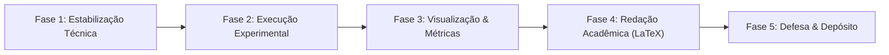

# Plano Mestre de Projeto: TCC — Framework LIARA
> **Tema:** Descentralização de Capacidades de Engenharia de Software via Orquestração Multiagente com Modelos de Linguagem Compactos (SLMs) em Hardware de Consumo.  
> **Formato:** Monografia / Artigo IEEE Transactions on Software Engineering (TSE).  
> **Contexto:** Projeto LIARA (*Lean Isolated Agents for Repair Automation*).

---

## Visão Geral e Alinhamento Estratégico

O objetivo central do seu TCC é demonstrar a viabilidade empírica e a eficiência de custo do **LIARA**: um sistema multiagente (Sully, Codey, Vera) alimentado exclusivamente por modelos compactos de código aberto (como Qwen2.5-Coder:14b / Llama-3.1-8B) executados localmente em hardware de consumidor para correção automática de bugs (SWE-bench Verified), sem dependência de APIs em nuvem e sem custos recorrentes.

O plano a seguir estrutura todas as atividades necessárias, desde o desbloqueio técnico imediato do orchestrator até a defesa perante a banca examinadora.

---

---

## Fase 1: Estabilização Técnica do Pipeline (Engenharia de Software)

O foco desta fase é sanar os gargalos observados nos testes recentes (`commit 7b30c67`), garantindo que o ciclo autônomo rode sem travamentos e com validação cirúrgica.

### 1.1. Restrição de Escopo do Sully (Sanitização Anti-Data Leakage)
- **Objetivo:** Impedir explicitamente que o agente Arquiteto (Sully) aponte arquivos de teste (ex: `tests/`, `*_test.py`, `test_*.py`) como alvos de modificação. O reparo deve ocorrer estritamente no código-fonte de produção do repositório, evitando falsos positivos e desqualificação metodológica no SWE-bench.
- **Arquivo Alvo:** [`openclaw_swe_benchmark/local_execution/main_orchestrator.py`](file:///home/bridge/Documentos/sma_liara/openclaw_swe_benchmark/local_execution/main_orchestrator.py)
- **Nível de Esforço:** **Médio** (~3 a 5 horas)
- **Dependências Críticas:** Nenhuma (prioridade zero).

### 1.2. Reforço da Aplicação de Patches do Codey ("The Scalpel" v4.4)
- **Objetivo:** Tratar as falhas recorrentes de `Patch não encontrado (strip+indent ou substring exata)` e erros sintáticos de fechamento de blocos (`unmatched ')'`, `unexpected indent`). Implementar um fallback de busca com normalização de quebras de linha/espaços em branco e uma validação de sintaxe prévia em memória (`ast.parse`) antes de acionar o container Docker.
- **Arquivo Alvo:** [`openclaw_swe_benchmark/local_execution/main_orchestrator.py`](file:///home/bridge/Documentos/sma_liara/openclaw_swe_benchmark/local_execution/main_orchestrator.py)
- **Nível de Esforço:** **Médio** (~4 a 6 horas)
- **Dependências Críticas:** 1.1.

### 1.3. Mecanismo Atômico de Rollback entre Tentativas de Reparo
- **Objetivo:** Garantir que quando uma tentativa do Codey falhar (tentativa 1 de 3), o arquivo modificado seja restaurado com precisão ao seu estado original limpo (`git checkout -- <file>`) antes da tentativa subsequente. Isso evita que falhas sintáticas ou blocos corrompidos poluam o contexto da tentativa seguinte.
- **Arquivo Alvo:** [`openclaw_swe_benchmark/local_execution/main_orchestrator.py`](file:///home/bridge/Documentos/sma_liara/openclaw_swe_benchmark/local_execution/main_orchestrator.py#L228-L233)
- **Nível de Esforço:** **Baixo** (~2 horas)
- **Dependências Críticas:** 1.2.

### 1.4. Definição da Amostra Experimental Viável (SWE-bench Verified N=30 a 50)
- **Objetivo:** Substituir a execução inviável de 300 issues em hardware de consumo por uma amostra estratificada e estatisticamente significativa de 30 a 50 issues do SWE-bench Verified (com semente determinística `seed=42`). O escopo deve conter diversidade representativa (ex: SymPy, Django, Requests) compatível com o tempo de inferência local.
- **Arquivo Alvo:** [`openclaw_swe_benchmark/local_execution/download_swebench.py`](file:///home/bridge/Documentos/sma_liara/openclaw_swe_benchmark/local_execution/download_swebench.py)
- **Nível de Esforço:** **Baixo** (~1 a 2 horas)
- **Dependências Críticas:** Nenhuma.

### 1.5. Smoke Test Integrado (Pipeline Check de 3 Issues)
- **Objetivo:** Executar o pipeline de ponta a ponta em 3 issues controladas para validar se o fluxo de diagnóstico (AST/Embeddings) $\rightarrow$ Sully $\rightarrow$ Codey $\rightarrow$ Docker $\rightarrow$ Vera $\rightarrow$ Gravação de Estado JSON funciona sem intervenção manual e sem vazamento de memória.
- **Arquivo Alvo:** `openclaw_swe_benchmark/local_execution/main_orchestrator.py`
- **Nível de Esforço:** **Baixo** (~2 horas de máquina + monitoramento)
- **Dependências Críticas:** 1.1, 1.2, 1.3, 1.4.

---

## Fase 2: Execução Experimental e Coleta de Métricas Empíricas

Esta fase produz o material empírico essencial do TCC: dados reais, logs brutos e comprovação do comportamento do enxame de SLMs.

### 2.1. Execução do Benchmark Completo da Amostra
- **Objetivo:** Executar a bateria de testes oficial com o modelo selecionado (ex: `Qwen2.5-Coder:14b` ou `Llama-3.1:8B`) gerando todos os arquivos `state_<instance_id>.json` com o histórico de prompts, patches, tracebacks e status final (resolvido/não resolvido).
- **Parâmetros:** `LIARA_MODEL=qwen2.5-coder:14b`, `LIARA_RETRIES=3`, amostragem calibrada.
- **Nível de Esforço:** **Alto** (~1 a 2 dias de execução contínua em segundo plano)
- **Dependências Críticas:** Fase 1 concluída com sucesso (1.5).

### 2.2. Script Automatizado de Agregação de Resultados (Data Mining de Logs)
- **Objetivo:** Criar um script analítico (ex: `aggregate_results.py`) que percorra a pasta `data/state_*.json` e gere um resumo consolidado contendo: taxa de resolução bruta (Pass@1, Pass@3), total de chamadas ao modelo, tempo médio por issue e consumo de memória.
- **Nível de Esforço:** **Baixo** (~2 a 3 horas)
- **Dependências Críticas:** 2.1.

### 2.3. Levantamento e Tabulação de Baselines da Literatura
- **Objetivo:** Extrair dos artigos de referência os números oficiais de modelos de ponta para comparação direta:
  - Monolíticos: GPT-4o e Claude 3.5 Sonnet no SWE-bench Verified.
  - Frameworks: SWE-agent (Vanilla) e SWE-smith (Yang et al., 2025).
  - Custo por patch resolvido ($/issue) e requisitos de hardware (número de GPUs/VRAM).
- **Arquivo Alvo:** [`artefatos/liara_positioning.md`](file:///home/bridge/Documentos/sma_liara/artefatos/liara_positioning.md)
- **Nível de Esforço:** **Baixo** (~2 horas)
- **Dependências Críticas:** Nenhuma.

### 2.4. Taxonomia Qualitativa de Falhas (Error Categorization)
- **Objetivo:** Analisar as issues que não foram resolvidas e categorizar os modos de falha do SLM em três grupos formais:
  1. *Localization Failure:* O Sully indicou o arquivo ou função incorreta.
  2. *Syntactic/Patch Failure:* O Codey compreendeu a correção mas falhou na formatação do diff/patch.
  3. *Logic/Semantic Failure:* O patch foi aplicado perfeitamente, mas a asserção de teste do SWE-bench não passou.
- **Nível de Esforço:** **Médio** (~4 a 5 horas)
- **Dependências Críticas:** 2.2.

---

## Fase 3: Visualização de Dados e Geração de Artefatos Gráficos

A banca de TCC avalia rigorosamente a clareza das evidências apresentadas. Esta fase converte os dados brutos em figuras prontas para publicação.

### 3.1. Geração Automatizada de Tabelas LaTeX
- **Objetivo:** Gerar as tabelas comparativas formatadas em sintaxe IEEEtran:
  - *Tabela I:* Desempenho comparativo (Modelo, Parâmetros, Tipo de Acesso, Custo por 100 issues, Pass@1).
  - *Tabela II:* Distribuição dos modos de falha observados no LIARA.
- **Nível de Esforço:** **Baixo** (~2 horas)
- **Dependências Críticas:** 2.2, 2.3, 2.4.

### 3.2. Gráficos Comparativos (Matplotlib/Seaborn de Qualidade de Publicação)
- **Objetivo:** Desenvolver script Python para renderizar gráficos vetoriais (`.pdf` ou `.png` em 300 DPI):
  - *Gráfico 1:* Relação Custo Financeiro vs. Taxa de Resolução (destacando o quadrante democratizado de custo zero do LIARA).
  - *Gráfico 2:* Resoluções acumuladas por tentativa (Tentativa 1 vs 2 vs 3).
- **Diretório Alvo:** `Computer_Society_LaTeX_template/`
- **Nível de Esforço:** **Médio** (~3 a 4 horas)
- **Dependências Críticas:** 2.2, 2.3.

### 3.3. Diagramas de Arquitetura e Fluxo (Figuras 1 e 2 do Artigo)
- **Objetivo:** Exportar os diagramas arquiteturais com acabamento profissional para inclusão no LaTeX:
  - *Figura 1:* Sequência e papéis discretos dos agentes (Sully $\rightarrow$ Codey $\rightarrow$ Vera).
  - *Figura 2:* Topologia de execução isolada (Ollama local + Sandbox Docker com isolamento de rede e sistema de arquivos).
- **Arquivo Alvo:** [`liara_architecture.md`](file:///home/bridge/Documentos/sma_liara/liara_architecture.md)
- **Nível de Esforço:** **Baixo** (~2 horas)
- **Dependências Críticas:** Nenhuma.

---

## Fase 4: Redação Acadêmica Rigorosa (Artigo IEEE TSE / Monografia)

Esta fase preenche os placeholders do template LaTeX e fundamenta teoricamente as decisões de projeto.

### 4.1. Curadoria do Arquivo de Referências (`references.bib`)
- **Objetivo:** Processar o inventário bibliográfico (Scopus export CSV e papers chave de APR/LLMs), gerando um arquivo `.bib` limpo, sem chaves duplicadas e no formato estrito do IEEE Transactions.
- **Arquivo Alvo:** [`Computer_Society_LaTeX_template/references.bib`](file:///home/bridge/Documentos/sma_liara/Computer_Society_LaTeX_template/references.bib)
- **Nível de Esforço:** **Médio** (~3 a 4 horas)
- **Dependências Críticas:** Nenhuma.

### 4.2. Seção 1 (Introduction) & Seção 2 (Related Work)
- **Objetivo:** Refinar a introdução enfatizando o dilema econômico e de soberania de dados do uso de LLMs em escala industrial. Na revisão bibliográfica, posicionar formalmente a lacuna científica: a ausência de estudos sistemáticos sobre orquestrações multiagente baseadas em SLMs locais sem fine-tuning (hipótese do *Lost in the Middle* mitigada por especialização de papéis).
- **Arquivo Alvo:** [`Computer_Society_LaTeX_template/main_article.tex`](file:///home/bridge/Documentos/sma_liara/Computer_Society_LaTeX_template/main_article.tex#L42-L57)
- **Nível de Esforço:** **Médio** (~4 a 6 horas)
- **Dependências Críticas:** 4.1.

### 4.3. Seção 3 (The LIARA Architecture & Formalization)
- **Objetivo:** Documentar detalhadamente as restrições estritas de cada agente: o modelo mental de três personas (Sully, Codey, Vera), o sistema de busca híbrida (AST + Embeddings), o motor "The Scalpel" de aplicação de patches e os limites de permissão do container Docker.
- **Arquivo Alvo:** [`Computer_Society_LaTeX_template/main_article.tex`](file:///home/bridge/Documentos/sma_liara/Computer_Society_LaTeX_template/main_article.tex#L58-L88)
- **Nível de Esforço:** **Médio** (~4 a 5 horas)
- **Dependências Críticas:** 3.3.

### 4.4. Seção 4 (Experimental Setup) & Seção 5 (Results & Discussion)
- **Objetivo:** Substituir todos os placeholders temporários (`X%`, `\$X.XX`) pelos números empíricos consolidados na Fase 2 e gráficos da Fase 3. Conduzir a discussão explicando detalhadamente o comportamento do modelo em cada categoria de erro.
- **Arquivo Alvo:** [`Computer_Society_LaTeX_template/main_article.tex`](file:///home/bridge/Documentos/sma_liara/Computer_Society_LaTeX_template/main_article.tex#L89-L120)
- **Nível de Esforço:** **Alto** (~6 a 8 horas)
- **Dependências Críticas:** 2.2, 2.3, 3.1, 3.2.

### 4.5. Seção 6 (Threats to Validity) & Seção 7 (Conclusion)
- **Objetivo:** Escrever a análise formal de ameaças à validade (validade interna: viés de seleção da amostra do SWE-bench; validade externa: generalização para outras linguagens além de Python; restrições de hardware de consumo). Concluir com a síntese das contribuições e direcionamentos de trabalhos futuros (ex: fine-tuning local direcionado com LoRA).
- **Arquivo Alvo:** [`Computer_Society_LaTeX_template/main_article.tex`](file:///home/bridge/Documentos/sma_liara/Computer_Society_LaTeX_template/main_article.tex#L121-L130)
- **Nível de Esforço:** **Médio** (~3 a 4 horas)
- **Dependências Críticas:** 4.4.

### 4.6. Revisão de Compilação, Tipografia e Consistência Global
- **Objetivo:** Compilar o documento completo no LaTeX/Overleaf, eliminar todos os `overfull \hbox`, assegurar que todas as referências cruzadas (`\ref`, `\cite`) estejam resolvidas sem `?` e verificar conformidade com o padrão institucional do TCC.
- **Nível de Esforço:** **Baixo** (~2 horas)
- **Dependências Críticas:** 4.1 a 4.5.

---

## Fase 5: Preparação para a Defesa de TCC e Encerramento Acadêmico

Garante que você domine a apresentação perante a banca e entregue todos os requisitos regulamentares.

### 5.1. Construção dos Slides da Defesa (Roteiro de 20 Minutos)
- **Objetivo:** Desenvolver uma apresentação concisa de 15 a 18 slides estruturados:
  1. O Problema (Custo e Monopólio dos LLMs Gigantes).
  2. A Proposta (LIARA: Multiagente SLM Local).
  3. Arquitetura e Engenharia (Sully, Codey, Vera + Isolamento).
  4. Resultados Empíricos (Gráficos de Custo × Resolução).
  5. Análise de Falhas e Lições Aprendidas.
  6. Conclusões e Trabalhos Futuros.
- **Nível de Esforço:** **Médio** (~4 a 6 horas)
- **Dependências Críticas:** 3.2, 4.4.

### 5.2. Gravação de Vídeo de Demonstração (Screencast de Segurança)
- **Objetivo:** Gravar uma demonstração de 2 minutos do LIARA resolvendo uma issue real do SWE-bench do início ao fim (ou preparar execução em terminal limpo com saída colorida). Serve como recurso de alto impacto durante a apresentação e contingência contra imprevistos de rede/hardware no dia da defesa.
- **Nível de Esforço:** **Baixo** (~2 horas)
- **Dependências Críticas:** 1.5.

### 5.3. Mock Defense (Simulação de Perguntas da Banca Examinadora)
- **Objetivo:** Antecipar e preparar respostas para os questionamentos mais prováveis da banca, tais como:
  - *"Por que não fazer fine-tuning direto em vez de criar um sistema multiagente?"*
  - *"Como vocês garantem que o modelo não decorou as soluções do SWE-bench?"*
  - *"Quais são os limites de escala para bases de código empresariais com centenas de arquivos?"*
- **Nível de Esforço:** **Baixo** (~2 a 3 horas)
- **Dependências Críticas:** 4.4, 4.5.

### 5.4. Sanitização e Empacotamento do Repositório (Open Science)
- **Objetivo:** Organizar o repositório público com instruções claras de reprodutibilidade no `README.md`, licença de código aberto e script de setup em 1 comando (`docker compose` ou script de bootstrap local), permitindo que a banca audite o trabalho se desejar.
- **Nível de Esforço:** **Baixo** (~2 horas)
- **Dependências Críticas:** 1.5.

### 5.5. Trâmites Institucionais e Depósito Final
- **Objetivo:** Submeter a monografia final no repositório institucional da faculdade/instituto (com ficha catalográfica e termo de autorização), respeitando os prazos regulamentares da coordenação de graduação.
- **Nível de Esforço:** **Baixo** (~1 hora)
- **Dependências Críticas:** Fase 4 e Fase 5 concluídas.

---

## Matriz de Priorização e Plano de Ação Imediato (Sprint de Arranque)

Para sair da inércia e focar no que destrava todo o restante do projeto, execute as tarefas na seguinte ordem cronológica:

| Ordem | Sub-tarefa | Descrição Rápida | Esforço |
|---|---|---|---|
| **1º** | **1.1** | Bloquear Sully de escolher arquivos de teste (`tests/`) | Médio |
| **2º** | **1.3** | Garantir rollback limpo (`git checkout`) entre retries | Baixo |
| **3º** | **1.2** | Blindar o patcher Codey (espaços/indentação + `ast.parse`) | Médio |
| **4º** | **1.4** | Reduzir a amostra de teste para 30 ou 50 issues (`seed=42`) | Baixo |
| **5º** | **1.5** | Rodar smoke test com 3 issues para validar o fluxo limpo | Baixo |
| **6º** | **2.1** | Disparar o benchmark oficial e focar na redação (Fase 4) enquanto roda | Alto |

> [!TIP]
> Enquanto o benchmark da Fase 2 estiver executando em segundo plano no hardware do laboratório ou desktop, você não precisa ficar ocioso: avance diretamente nas seções teóricas do artigo no LaTeX (Sub-tarefas 4.1, 4.2 e 4.3).
