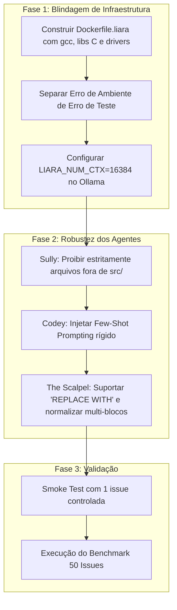

# Estudo de Falhas dos Testes & Plano de Correção do Benchmark LIARA

**Data do Estudo:** 01 de Outubro de 2026  
**Autor:** Antigravity (Pair Programming / TCC LIARA)  
**Artefatos Analisados:** `data/agent_dialogue_0417_1831.txt`, `data/state_*.json`, `openclaw_swe_benchmark/local_execution/main_orchestrator.py`

---

## 1. Veredito Executivo: Infraestrutura ou Lógica dos Agentes?

> [!IMPORTANT]
> **Conclusão Forense:** O projeto falhou por uma **falha em cascata iniciada na infraestrutura de execução**, que por sua vez **envenenou a lógica dos agentes** (Feedback Poisoning).
> 
> Não se trata de uma causa isolada:
> 1. **Gatilho Primário (Infraestrutura):** A imagem Docker utilizada (`python:3.9-slim`) não possui dependências de sistema (como bibliotecas C, `libpq-dev`, `gcc`, `default-libmysqlclient-dev`, `numpy`), e a instalação silenciosa (`pip install -e . -q`) mascara falhas de compilação.
> 2. **Distorção de Raciocínio (Lógica dos Agentes):** Quando o teste de reprodução inicial do SWE-bench roda, ele não falha pelo bug da issue, mas sim por `ModuleNotFoundError` (ex: `No module named 'psycopg2'` ou `'MySQLdb'`). O orquestrador assume erroneamente que o bug foi reproduzido com sucesso (`BUG DETECTADO ✓`), extrai esse traceback de ambiente e o entrega ao **Sully** e ao **Codey**. Os agentes passam então a tentar corrigir scripts de setup de testes e arquivos de banco de dados, em vez do bug real da aplicação.
> 3. **Gargalo Secundário (Lógica dos Agentes):** Nas issues onde o ambiente rodou minimamente (ex: Sympy), o **Codey** gerou patches com formatações inválidas (alucinações como `REPLACE WITH:`, elipses `...`, múltiplos blocos `SEARCH:` na mesma resposta e perda de indentação), que foram rejeitados pelo mecanismo *"The Scalpel"*.

---

## 2. Evidências Forenses Extraídas dos Logs

### Caso 1: Django (`django__django-11211` e `test_sqlite`)
*Trecho do Log `data/agent_dialogue_0417_1831.txt` (linhas 265–368) e `data/state_django__django-11211.json`*

1. **Falha de Ambiente no Docker:**
   ```text
   Traceback (most recent call last):
     File "/app/django/db/backends/postgresql/base.py", line 25, in <module>
       import psycopg2 as Database
   ModuleNotFoundError: No module named 'psycopg2'
   ```
   e no outro caso:
   ```text
   Traceback (most recent call last):
     File "/app/tests/runtests.py", line 27, in <module>
       import MySQLdb
   ModuleNotFoundError: No module named 'MySQLdb'
   ```
2. **Reação do Sully (Localização Desviada):**
   Como o traceback quebrou dentro do harness de testes do Django, Sully apontou:
   ```json
   {
     "file": "./tests/test_sqlite.py",
     "function": "test_sqlite"
   }
   ```
   *Problema:* Sully escolheu um arquivo de configuração de teste em vez de código de produção (data leakage / má localização).
3. **Reação do Codey (Tentativa de remendo do ambiente):**
   Codey tentou trocar o banco de dados de SQLite para PostgreSQL em `DATABASES`, depois tentou importar `os` gerando `NameError: name 'os' is not defined`. O agente entrou em um loop destrutivo tentando resolver o ambiente da máquina e não o problema da issue.

---

### Caso 2: Sympy (`sympy__sympy-19783` — Quantum Dagger & Operator)
*Trecho do Log `data/agent_dialogue_0417_1831.txt` (linhas 450–800) e `data/state_sympy__sympy-19783.json`*

1. **Contexto Sobrecarregado & Truncamento:**
   O arquivo `sympy/physics/quantum/operator.py` é extenso. O orquestrador injetou mais de 300 linhas de código no prompt.
2. **Alucinação de Formato pelo Codey:**
   O Codey gerou o seguinte bloco:
   ```text
   REPLACE WITH:
   from sympy.physics.quantum import Operator, HermitianOperator, UnitaryOperator, IdentityOperator, OuterProduct, DifferentialOperator

   class Operator(QExpr):
       ...
   class HermitianOperator(Operator):
       ...
   ```
   - Usou `REPLACE WITH:` em vez de `REPLACE:`.
   - Inseriu elipses (`...`), o que apagaria todo o miolo das classes!
   - Em outra tentativa (linhas 813-960), gerou múltiplos blocos `SEARCH:` / `REPLACE:` na mesma resposta.
   - O orquestrador retornou: `Patch format invalid.` e `Patch failed: ERROR: Patch não encontrado (strip+indent ou substring exata).`

---

### Caso 3: Sympy (`sympy__sympy-19954` — Sylow Subgroup IndexError)
*Trecho do Log `data/agent_dialogue_0417_1831.txt` (linhas 4–140) e `data/state_sympy__sympy-19954.json`*

1. **Localização Falha do Sully:**
   A issue descrevia claramente um `IndexError` ao invocar `sylow_subgroup()`. No entanto, o Sully indicou:
   ```json
   {
     "file": "sympy/combinatorics/perm_groups.py",
     "function": "minimal_blocks"
   }
   ```
   Ele acertou o arquivo, mas errou o escopo da função, forçando o Codey a olhar para o método errado.
2. **Drift de Indentação:**
   O Codey gerou o patch removendo todos os espaços iniciais das linhas (linhas 82–92 do log). O orquestrador acusou:
   ```text
   Scalpel Error: unexpected indent (<unknown>, line 2193)
   ```
3. **Ausência de Pacotes de Teste no Docker:**
   O log de teste do Sympy apontou:
   ```text
   File "/app/sympy/physics/quantum/tests/test_dagger.py", line 48, in test_numpy_dagger
     pytest.skip("numpy not installed.")
   NameError: name 'pytest' is not defined
   ```

---

## 3. Matriz Comparativa: Infraestrutura vs. Lógica dos Agentes

| Componente | Tipo de Falha | Manifestação nos Logs | Causa Raiz |
|---|---|---|---|
| **Sandbox Docker** | **Infraestrutura** | `ModuleNotFoundError: No module named 'psycopg2' / 'MySQLdb'` | Imagem `python:3.9-slim` sem ferramentas C (`gcc`, headers) e libs nativas. |
| **Setup de Dependências** | **Infraestrutura** | `pip install -e . -q` falha silenciosamente | O sinalizador `-q` oculta erros de build de C extensions no pip. |
| **Detecção de Bug Inicial** | **Infraestrutura / Orquestrador** | `[REPRO] BUG DETECTADO ✓` mesmo quando o container quebrou por importação | `pre_ok` falso é tratado indistintamente como "bug confirmado". |
| **Janela de Contexto Ollama** | **Infraestrutura / Configuração** | Codey respondendo de forma preguiçosa com `...` | `num_ctx` padrão (2048) estoura com contexto AST + prompt. |
| **Sully (Arquiteto)** | **Lógica do Agente** | Escolha de `./tests/test_sqlite.py` ou função equivocada | Falta de sanitização rigorosa anti-leakage e dependência de heurísticas simples. |
| **Codey (Coder)** | **Lógica do Agente** | `REPLACE WITH:`, múltiplos `SEARCH:` ou perda de indentação | Falta de few-shot examples rígidos no system prompt e alucinação de delimitadores. |
| **The Scalpel (Patcher)** | **Lógica / Ferramenta** | `Patch format invalid` ou `Patch não encontrado` | Parser espera estritamente um bloco único e não recupera tags variantes. |
| **Vera (QA)** | **Lógica / Orquestrador** | Traceback de falta de pacote repassado para o Codey | Falta de filtro entre falha de compilação/importação vs. falha de asserção de teste. |

---

## 4. Plano de Ação & Correção para as Issues Passarem

O plano está estruturado em 3 fases prioritárias.



---

### Fase 1: Correção da Infraestrutura de Execução (Prioridade Máxima)

#### 1.1 Criar uma Imagem Docker Base Completa (`Dockerfile.liara`)
Em vez de usar `python:3.9-slim` "pura", crie uma imagem Docker com todo o ecossistema necessário pré-instalado.
No diretório `openclaw_swe_benchmark/local_execution/`:

**Arquivo:** `openclaw_swe_benchmark/local_execution/Dockerfile.liara`
```dockerfile
FROM python:3.9-bullseye

# Instala ferramentas essenciais de compilação e bibliotecas de sistema C/C++
RUN apt-get update && apt-get install -y --no-install-recommends \
    build-essential \
    gcc \
    g++ \
    gfortran \
    git \
    libpq-dev \
    default-libmysqlclient-dev \
    libsqlite3-dev \
    libopenblas-dev \
    liblapack-dev \
    pkg-config \
    && rm -rf /var/lib/apt/lists/*

# Atualiza pip e instala dependências comuns que quebram o benchmark
RUN pip install --no-cache-dir --upgrade pip setuptools wheel
RUN pip install --no-cache-dir \
    pytest \
    pytest-django \
    pytest-mock \
    tox \
    numpy \
    scipy \
    psycopg2-binary \
    sqlite3
```
*Build da imagem na máquina de execução:*
```bash
docker build -t liara-sandbox:3.9 -f Dockerfile.liara .
```
E alterar em `main_orchestrator.py` linha 642 de `"python:3.9-slim"` para `"liara-sandbox:3.9"`.

#### 1.2 Distinguir Erro de Ambiente de Falha de Teste Real
Em `main_orchestrator.py`, adicione uma verificação na **Fase 1 (Reprodução do Bug)**:
Se a saída contiver `ModuleNotFoundError` ou `ImportError`, o orquestrador deve abortar ou tentar instalar o pacote ausente via `pip install`, em vez de passar essa saída ao Sully como se fosse o bug do benchmark:
```python
if "modulenotfounderror" in pre_results.lower():
    missing_mod = re.findall(r"No module named '([^']+)'", pre_results)
    if missing_mod:
        print(f"[SETUP AUTO-FIX] Instalando módulo faltante: {missing_mod[0]}")
        run_in_docker(container_name, f"pip install {missing_mod[0]}")
        # Roda o teste novamente para validar reprodução real
        pre_ok, pre_results = run_in_docker(container_name, test_script, return_exit_code=True)
```

#### 1.3 Garantir Contexto do Ollama Suficiente
No comando de execução, passe explicitamente:
```bash
export LIARA_NUM_CTX=16384
export LIARA_NUM_PREDICT=2048
```
Isso impede que o modelo resuma código com `...` por exaustão de contexto.

---

### Fase 2: Correção da Lógica dos Agentes

#### 2.1 Reforço Anti-Alucinação no Prompt do Codey (Few-Shot)
O prompt atual não ensina explicitamente o que NÃO fazer. Adicione exemplos negativos e positivos no prompt de Codey em `main_orchestrator.py`:

```python
codey_prompt = """You are Codey, a precision code editor. Output ONLY a single SEARCH/REPLACE block.
Do NOT chatter. Do NOT use markdown outside the block.
NEVER use '...' or placeholder comments.
NEVER use 'REPLACE WITH:'. Use strictly 'REPLACE:'.
ONLY output ONE SEARCH and ONE REPLACE pair per response.

CORRECT EXAMPLE:
SEARCH:
    def calculate(x):
        return x + 1
REPLACE:
    def calculate(x):
        if x is None:
            return 0
        return x + 1
"""
```

#### 2.2 Tolerância Sintática no "The Scalpel"
No arquivo `main_orchestrator.py` (`apply_codey_patch`):
1. Adicione suporte a `REPLACE WITH:` convertendo-o para `REPLACE:` antes do split.
2. Trate respostas onde o modelo gera múltiplos blocos `SEARCH:/REPLACE:`, aplicando o primeiro bloco válido ou iterando sobre eles.

#### 2.3 Blindagem Total de Sully contra Diretórios de Teste
Certifique-se de que a sanitização implementada na versão 4.5.0 (`is_test_path`) descarte qualquer arquivo com `test` no caminho. Se Sully responder com um arquivo de teste, o orquestrador deve forçar imediatamente o fallback para o primeiro arquivo de produção identificado pelo AST:
```python
if is_test_path(target_rel):
    print(f"[ANTI-LEAKAGE] Rejeitando arquivo de teste sugerido pelo Sully ({target_rel}).")
    target_rel = production_candidates[0]
```

---

### Fase 3: Roteiro de Execução & Teste de Validação

Para validar as correções sem consumir horas de execução:

1. **Passo 1 (Build da nova imagem Docker):**
   ```bash
   cd openclaw_swe_benchmark/local_execution
   docker build -t liara-sandbox:3.9 -f Dockerfile.liara .
   ```
2. **Passo 2 (Subir Ollama com contexto ampliado):**
   ```bash
   OLLAMA_NUM_PARALLEL=1 ollama serve
   ```
3. **Passo 3 (Smoke Test com 1 Issue Controlada):**
   Crie uma amostra unitária com a issue `sympy__sympy-19783`:
   ```bash
   LIARA_MODEL=qwen2.5-coder:14b \
   LIARA_NUM_CTX=16384 \
   LIARA_SAMPLE=data/swebench_sample_1.json \
   LIARA_RETRIES=2 \
   python3 main_orchestrator.py
   ```
4. **Passo 4 (Auditoria do Estado):**
   Verifique `data/state_*.json`. Se `resolved: true`, avance para a amostra de 50 issues (`data/swebench_sample_50.json`).
