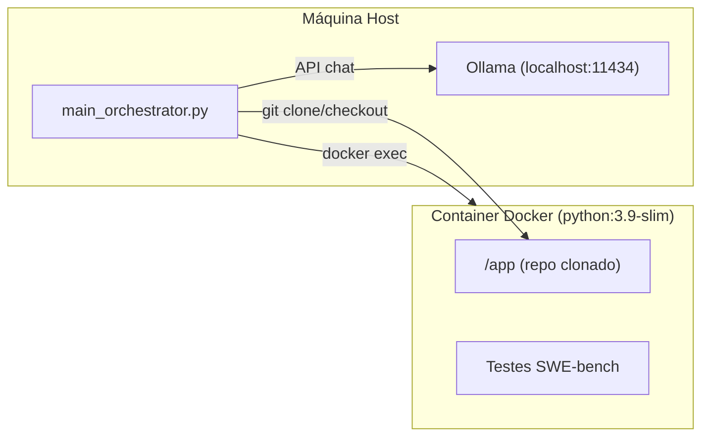
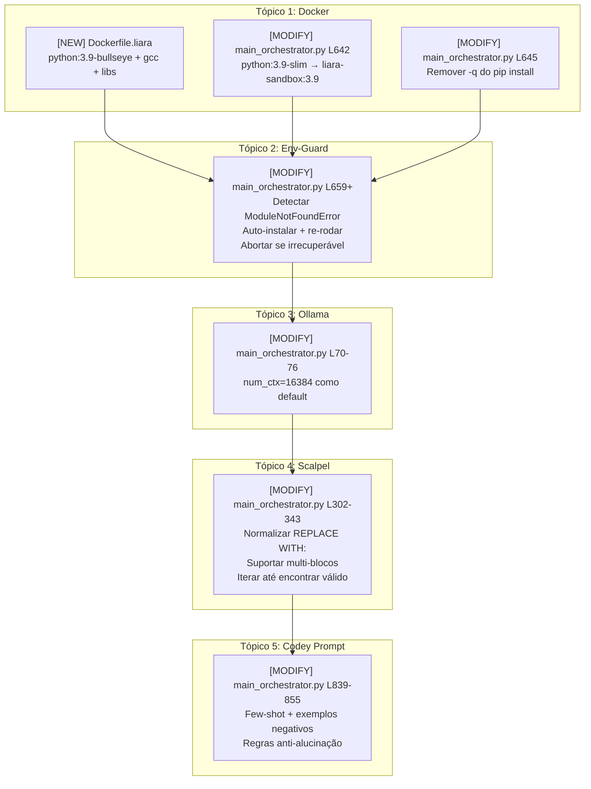

# Plano de Correção dos Erros de Execução do LIARA

## Objetivo

Corrigir os principais problemas que impedem o benchmark LIARA de resolver issues corretamente no SWE-bench. A análise forense em [estudo_falhas_e_plano_correcao.md](file:///home/carol-lanzu/Documents/artigo-UFSC/sma_liara/artefatos/estudo_falhas_e_plano_correcao.md) identificou uma **falha em cascata**: a infraestrutura Docker incompleta gera erros de importação que envenenam o raciocínio dos agentes LLM.

Este plano detalha todas as mudanças necessárias, agrupadas por componente, com código, diffs e estratégia de verificação.

---

## Contexto da Arquitetura Atual



**Problema central:** O container usa `python:3.9-slim`, que não tem compilador C (`gcc`), headers de bibliotecas de sistema (`libpq-dev`, `libmysqlclient-dev`), nem ferramentas de build. Quando o `pip install -e . -q` roda silenciosamente, pacotes como `psycopg2` e `MySQLdb` falham na compilação sem aviso. Os testes então quebram por `ModuleNotFoundError`, e o orquestrador interpreta isso como o bug real da issue.

---

## User Review Required

> [!IMPORTANT]
> **Decisão: Imagem base Docker** — O plano propõe usar `python:3.9-bullseye` (Debian full, ~900MB) em vez de `python:3.9-slim` (~150MB). Isso aumenta o espaço em disco e o tempo do primeiro build, mas elimina os problemas de compilação de C extensions. Confirme se o espaço em disco do ambiente de execução suporta isso sem problemas.

> [!IMPORTANT]
> **Decisão: `num_ctx` padrão** — O plano propõe definir `LIARA_NUM_CTX=16384` como padrão interno no código (em vez de depender de variável de ambiente). Isso consome mais VRAM/RAM no Ollama. Confirme se o hardware disponível suporta esse contexto com o modelo `qwen2.5-coder:14b`.

> [!WARNING]
> **Mudança de comportamento: Auto-install de dependências** — Na detecção de `ModuleNotFoundError`, o orquestrador tentará instalar o módulo faltante automaticamente e re-rodar o teste. Se preferir que ele simplesmente aborte a issue em vez de tentar auto-fix, indique.

---

## Proposed Changes

As mudanças estão organizadas em **5 tópicos independentes**, cada um atacando uma causa raiz diferente. A ordem de implementação reflete a prioridade (infraestrutura primeiro, lógica dos agentes depois).

---

### Tópico 1 — Infraestrutura Docker: Imagem Base Completa

**Causa raiz:** `python:3.9-slim` não tem `gcc`, `build-essential`, headers C, e drivers de banco de dados. Pacotes Python com C extensions falham silenciosamente durante `pip install -e . -q`.

#### [NEW] `openclaw_swe_benchmark/local_execution/Dockerfile.liara`

Criar uma imagem Docker dedicada ao LIARA com todas as dependências de sistema pré-instaladas:

```dockerfile
# Dockerfile.liara — Imagem de sandbox completa para benchmark LIARA
# Build: docker build -t liara-sandbox:3.9 -f Dockerfile.liara .
FROM python:3.9-bullseye

# Ferramentas de compilação e bibliotecas de sistema necessárias
# para C extensions de projetos Python do SWE-bench
RUN apt-get update && apt-get install -y --no-install-recommends \
    build-essential \
    gcc \
    g++ \
    gfortran \
    git \
    libpq-dev \
    default-libmysqlclient-dev \
    libsqlite3-dev \
    libopenblas-dev \
    liblapack-dev \
    libffi-dev \
    libssl-dev \
    pkg-config \
    && rm -rf /var/lib/apt/lists/*

# Pip atualizado e dependências comuns de teste/benchmark
RUN pip install --no-cache-dir --upgrade pip setuptools wheel && \
    pip install --no-cache-dir \
    pytest \
    pytest-django \
    pytest-mock \
    pytest-xdist \
    tox \
    numpy \
    scipy \
    psycopg2-binary \
    mysqlclient \
    hypothesis
```

#### [MODIFY] `main_orchestrator.py` — Trocar imagem Docker (linha 642)

```diff
-                    "python:3.9-slim", "tail", "-f", "/dev/null"], check=True)
+                    "liara-sandbox:3.9", "tail", "-f", "/dev/null"], check=True)
```

#### [MODIFY] `main_orchestrator.py` — Remover flag `-q` do pip install (linha 645)

O `-q` (quiet) esconde erros de compilação. Trocar por output verboso que é capturado pelo log:

```diff
-    run_in_docker(container_name, "pip install -e . -q")
-    run_in_docker(container_name, "pip install pytest pytest-django pytest-mock tox -q")
+    # LIARA v4.6: Output verboso para diagnosticar falhas de instalação
+    install_result = run_in_docker(container_name, "pip install -e . 2>&1 | tail -n 30")
+    print(f"[SETUP] pip install -e . resultado: {install_result[:500]}")
+    run_in_docker(container_name, "pip install pytest pytest-django pytest-mock tox 2>&1 | tail -n 10")
```

---

### Tópico 2 — Detecção de Erro de Ambiente vs. Erro de Teste Real

**Causa raiz:** O orquestrador trata qualquer falha na Fase 1 (reprodução do bug) como "bug confirmado". Se o container quebrou por `ModuleNotFoundError` ou `ImportError`, isso é um problema de infraestrutura, não o bug da issue.

#### [MODIFY] `main_orchestrator.py` — Adicionar guarda pós-reprodução (entre linhas 659–660)

Inserir lógica de detecção e auto-reparo de dependências faltantes **logo após** o bloco `[REPRO]`:

```python
    # === LIARA v4.6: Guarda contra Feedback Poisoning ===
    # Detecta se o teste falhou por erro de AMBIENTE (dependência faltante)
    # e não pelo bug real da issue. Se sim, tenta instalar e re-rodar.
    ENV_ERROR_PATTERNS = [
        (r"ModuleNotFoundError: No module named '([^']+)'", "ModuleNotFoundError"),
        (r"ImportError: No module named '([^']+)'", "ImportError"),
        (r"ImportError: cannot import name '([^']+)'", "ImportError"),
    ]

    max_env_fixes = 3  # Limite de auto-fix para evitar loop infinito
    for env_fix_attempt in range(max_env_fixes):
        env_error_found = False
        for pattern, err_type in ENV_ERROR_PATTERNS:
            match = re.search(pattern, pre_results)
            if match:
                missing_mod = match.group(1).split('.')[0]  # Pega módulo raiz
                print(f"[ENV-GUARD] {err_type} detectado: '{missing_mod}' — "
                      f"Isso é erro de AMBIENTE, não o bug da issue. "
                      f"Tentando auto-fix ({env_fix_attempt + 1}/{max_env_fixes})...")
                log_dialogue("ENV-GUARD", f"Auto-instalando módulo faltante: {missing_mod}")
                run_in_docker(container_name, f"pip install {missing_mod} 2>&1 | tail -5")
                # Re-executa o teste
                pre_ok, pre_results = run_in_docker(container_name, test_script, return_exit_code=True)
                env_error_found = True
                break  # Reinicia o loop for para checar novos erros
        if not env_error_found:
            break  # Nenhum erro de ambiente restante

    # Recalcula bug_detected após possíveis auto-fixes de ambiente
    bug_detected = (not pre_ok) or any(
        t in pre_results.lower() for t in ("failed", "traceback", "assertionerror", "errors=")
    )

    # Se AINDA houver ModuleNotFoundError após auto-fix, abortar a issue
    if re.search(r"ModuleNotFoundError|ImportError", pre_results):
        remaining = re.findall(r"No module named '([^']+)'", pre_results)
        if remaining:
            print(f"[ENV-GUARD] ⚠ Dependência irrecuperável: {remaining}. "
                  f"Abortando issue para evitar Feedback Poisoning.")
            log_dialogue("ENV-GUARD", f"Issue abortada: dependência {remaining} não instalável.")
            state["errors"].append({"attempt": 0, "error": f"Env dependency failure: {remaining}"})
            save_state(instance_id, state)
            os.system(f"docker rm -f {container_name} > /dev/null 2>&1")
            return False

    print(f"[REPRO] {'BUG DETECTADO ✓' if bug_detected else 'PASSOU (inesperado)'} (pós env-guard)")
```

> [!NOTE]
> Este bloco substitui o `print(f"[REPRO] ...")` existente na linha 659. O `bug_detected` original (linhas 656–658) é mantido como cálculo inicial, mas é **recalculado** após o env-guard para refletir o estado real.

---

### Tópico 3 — Contexto do Ollama: `num_ctx` Padrão Seguro

**Causa raiz:** Sem `LIARA_NUM_CTX` definido, o Ollama usa o padrão de 2048 tokens. Com prompts de AST + função + issue, o contexto estoura e o modelo gera respostas truncadas com `...` (elipses).

#### [MODIFY] `main_orchestrator.py` — Definir defaults internos (linhas 70–76)

```diff
     opts = {}
-    if os.environ.get("LIARA_NUM_PREDICT"):
-        opts["num_predict"] = int(os.environ["LIARA_NUM_PREDICT"])
-    if os.environ.get("LIARA_NUM_CTX"):
-        opts["num_ctx"] = int(os.environ["LIARA_NUM_CTX"])
+    # LIARA v4.6: Defaults seguros — evita truncamento por contexto curto
+    opts["num_predict"] = int(os.environ.get("LIARA_NUM_PREDICT", "2048"))
+    opts["num_ctx"] = int(os.environ.get("LIARA_NUM_CTX", "16384"))
     if opts:
         data["options"] = opts
```

> [!TIP]
> Isso garante que **mesmo sem definir variáveis de ambiente**, o Ollama usará 16384 tokens de contexto e 2048 de predição. Valores customizados via ambiente continuam funcionando normalmente.

---

### Tópico 4 — Robustez do "The Scalpel" (Parser de Patches)

**Causa raiz:** O Codey às vezes gera `REPLACE WITH:` em vez de `REPLACE:`, ou gera múltiplos blocos `SEARCH:/REPLACE:` na mesma resposta. O parser atual rejeita tudo silenciosamente.

#### [MODIFY] `main_orchestrator.py` — Normalizar variantes de delimitadores em `apply_codey_patch` (linhas 302–322)

```python
def apply_codey_patch(codey_response, target_abs, repo_path=None):
    """Extrai, aplica e pré-valida sintaticamente o patch SEARCH/REPLACE (The Scalpel)."""
    clean_resp = codey_response.replace("\r\n", "\n").replace("\r", "\n")

    # LIARA v4.6: Normaliza variantes comuns de delimitadores antes do parsing
    # O modelo às vezes gera "REPLACE WITH:" em vez de "REPLACE:"
    clean_resp = re.sub(r'REPLACE\s+WITH\s*:', 'REPLACE:', clean_resp, flags=re.IGNORECASE)
    # Normaliza **SEARCH**: ou *SEARCH*: para SEARCH:
    clean_resp = re.sub(r'\*{1,2}(SEARCH|REPLACE)\*{1,2}\s*:', r'\1:', clean_resp)

    parts = re.split(r"(?:^|\n)\s*(?:```[a-zA-Z]*\n)?\s*SEARCH:", clean_resp)
    if len(parts) < 2:
        return False, "SEARCH/REPLACE block not found or malformed (missing SEARCH:)."

    # LIARA v4.6: Se há múltiplos blocos SEARCH:, usa o primeiro válido
    results = []
    for block_idx, search_rest in enumerate(parts[1:], 1):
        replace_parts = re.split(r"(?:^|\n)\s*REPLACE:", search_rest)
        if len(replace_parts) < 2:
            continue

        old_str = clean_block_fences(replace_parts[0])
        raw_replace = replace_parts[1].split("SEARCH:")[0]
        new_str = clean_block_fences(raw_replace)

        if not old_str.strip():
            continue

        result = fuzzy_apply_edit(target_abs, old_str, new_str)
        print(f"[CODEY] Bloco {block_idx}: {result}")
        if "SUCCESS" in result.upper():
            ok, err = validate_patch_syntax(target_abs)
            if ok:
                print(f"[VALIDA] ✓ Sintaxe OK (bloco {block_idx})")
                return True, ""
            else:
                print(f"[VALIDA] ✗ Bloco {block_idx} gerou sintaxe inválida: {err}. Tentando próximo bloco...")
                if repo_path:
                    rollback_file(repo_path, target_abs)
                results.append((False, err))
                continue
        results.append((False, result))

    # Nenhum bloco funcionou
    if repo_path:
        rollback_file(repo_path, target_abs)
    error_summary = "; ".join(r[1] for r in results) if results else "Nenhum bloco SEARCH/REPLACE válido encontrado."
    return False, f"Patch format invalid: {error_summary}"
```

> [!NOTE]
> Esta é uma **reescrita completa** da função `apply_codey_patch`. A versão atual (linhas 302–343) é substituída integralmente. A nova versão:
> 1. Normaliza `REPLACE WITH:` → `REPLACE:` antes do split
> 2. Itera sobre múltiplos blocos SEARCH/REPLACE, aplicando o primeiro que passa na validação AST
> 3. Faz rollback automático se um bloco gera sintaxe inválida, antes de tentar o próximo

---

### Tópico 5 — Reforço Anti-Alucinação no Prompt do Codey

**Causa raiz:** O prompt atual do Codey não ensina explicitamente o que **NÃO** fazer. O modelo alucina `REPLACE WITH:`, usa elipses `...`, e gera múltiplos blocos sem instrução clara.

#### [MODIFY] `main_orchestrator.py` — Novo prompt do Codey (linhas 839–855)

```python
    codey_prompt = """You are Codey, a code editor. Your ONLY job is to output a SEARCH/REPLACE block.
Do NOT explain. Do NOT chatter. Do NOT add markdown outside the block.

ABSOLUTE RULES:
1. The SEARCH block MUST match the provided code EXACTLY (same leading spaces on every line).
2. SEARCH must cover complete statements: if you include "if/for/while/try:", include the full body.
3. ONLY fix the bug implied by the problem statement and test failure.
4. NEVER use '...' or placeholder comments to skip code. Write out ALL lines completely.
5. NEVER use 'REPLACE WITH:'. The correct keyword is 'REPLACE:'.
6. Output exactly ONE SEARCH and ONE REPLACE pair per response.
7. If you cannot find the bug, output 'ERROR: Bug not found in context'.
8. Finish every string, bracket, and line you opened. Never truncate.
9. Preserve ALL existing indentation from the Code section.

CORRECT FORMAT EXAMPLE:
SEARCH:
    def calculate(x):
        return x + 1
REPLACE:
    def calculate(x):
        if x is None:
            return 0
        return x + 1

WRONG (will be REJECTED):
- Using 'REPLACE WITH:' instead of 'REPLACE:'
- Using '...' to skip lines
- Multiple SEARCH/REPLACE blocks
- Changing indentation"""
```

---

## Resumo Visual das Mudanças



## Arquivos Afetados

| Arquivo | Ação | Tópico |
|---|---|---|
| [`Dockerfile.liara`](file:///home/carol-lanzu/Documents/artigo-UFSC/sma_liara/openclaw_swe_benchmark/local_execution/Dockerfile.liara) | **NOVO** | 1 |
| [`main_orchestrator.py`](file:///home/carol-lanzu/Documents/artigo-UFSC/sma_liara/openclaw_swe_benchmark/local_execution/main_orchestrator.py) | **MODIFICAR** (5 pontos) | 1, 2, 3, 4, 5 |

---

## Verification Plan

### Automated Tests

#### 1. Build da imagem Docker (Tópico 1)
```bash
cd openclaw_swe_benchmark/local_execution
docker build -t liara-sandbox:3.9 -f Dockerfile.liara .
# Verificar que gcc e libs estão disponíveis:
docker run --rm liara-sandbox:3.9 gcc --version
docker run --rm liara-sandbox:3.9 python -c "import psycopg2; print('psycopg2 OK')"
docker run --rm liara-sandbox:3.9 python -c "import numpy; print('numpy OK')"
```

#### 2. Validação de sintaxe do código modificado (Todos os tópicos)
```bash
cd openclaw_swe_benchmark/local_execution
python3 -c "import ast; ast.parse(open('main_orchestrator.py').read()); print('Syntax OK')"
```

#### 3. Smoke test com 1 issue controlada (Integração)
```bash
cd openclaw_swe_benchmark/local_execution
LIARA_MODEL=qwen2.5-coder:14b \
LIARA_NUM_CTX=16384 \
LIARA_SAMPLE=data/swebench_sample_1.json \
LIARA_RETRIES=2 \
python3 main_orchestrator.py
```

### Manual Verification

1. **Verificar logs do Env-Guard:** Após o smoke test, inspecionar o arquivo de diálogo em `data/agent_dialogue_*.txt` e procurar por `[ENV-GUARD]`. Se houve auto-instalação, a mensagem deve aparecer.

2. **Verificar ausência de `ModuleNotFoundError` no raciocínio dos agentes:** Nas seções `[SULLY]` e `[CODEY]` do log, NÃO deve haver tracebacks de `ModuleNotFoundError` sendo tratados como se fossem o bug da issue.

3. **Verificar `state_*.json`:** O campo `resolved` deve ser `true` para a issue de smoke test (se ela for uma issue que o sistema consegue resolver). Se `resolved: false`, inspecionar `errors` para verificar que os erros são de lógica do agente e NÃO de infraestrutura.

4. **Verificar formato dos patches:** Nos logs, a seção `[CODEY]` NÃO deve conter `REPLACE WITH:` nem elipses `...` nos blocos de patch.
